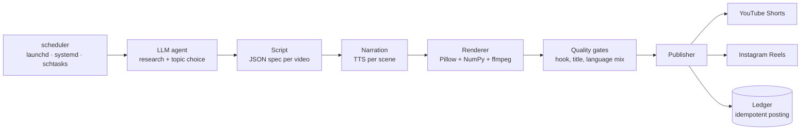

# CreatorOS Autopilot

Research what is new in your niche, write each video as a JSON spec, voice it, render an
animated 1080×1920 MP4, and publish it to YouTube Shorts and Instagram Reels — on your own
machine, with your own keys.

It runs the [Nexlore AI](https://www.youtube.com/@NexloreAI/shorts) channels every day:
[YouTube](https://www.youtube.com/@NexloreAI/shorts) · [Instagram](https://www.instagram.com/nexloreai/reels/)

> **Status: early.** Phases 1 and 2 of [the roadmap](docs/ROADMAP.md) have landed — an
> installable package with a cross-platform CLI, and a plugin system where every provider
> is an entry point. Brand kits and the `creatoros init` wizard are Phase 3. Expect the
> command surface to be stable and the internals to move.

## Try it — no keys, no accounts

```bash
pip install creatoros-autopilot      # Python 3.10+; also needs ffmpeg on PATH
creatoros doctor                     # says exactly what is missing, if anything
creatoros render examples/specs/kv-cache.json -o kv-cache.mp4
```

That writes a real 33-second video. Nothing is uploaded anywhere, and nothing asks you for
a key — rendering is the part that is free and offline, and it is deliberately the first
thing you can do.

Or without installing anything but Docker:

```bash
docker compose run --rm creatoros render examples/specs/kv-cache.json -o /workspace/out.mp4
```

## How it works



1. **Research.** A headless LLM agent searches recent news and papers, scans what is
   working for similar creators, and picks topics not covered before.
2. **Script.** Each video becomes a JSON spec: typed scenes (`hook`, `section`, `stat`,
   `points`, `predict`, `cta`), a narration line per scene, sources, and per-platform
   metadata. The spec is the job — everything downstream reads it and nothing else.
3. **Voice.** One clip per scene. A clip is only regenerated when its line changed, so a
   re-render does not re-bill the whole video.
4. **Render.** Every frame is drawn at 2× with Pillow and NumPy — animated grid, glass
   cards, code chips, progress bar — timed to the narration, with the music ducked under
   the voice, then encoded with ffmpeg.
5. **Publish.** The same MP4 goes to each platform at its slot. Every post is recorded in
   a ledger keyed on `(job id, platform)`, so a re-run never double-posts and a partial
   failure retries only the platform that failed.

## Commands

| | |
|---|---|
| `creatoros doctor` | check dependencies, config and keys; says what to fix |
| `creatoros render SPEC` | spec → MP4 (and a cover frame) |
| `creatoros preview SPEC` | contact sheet of every scene, to check layout before rendering |
| `creatoros audio SPEC` | narration + a music bed |
| `creatoros publish VIDEO` | publish one video (`--dry-run` prints the payload and calls nothing) |
| `creatoros run` | a full day: make the videos, then publish them |
| `creatoros status` | what has run, what is still pending |
| `creatoros schedule show\|install\|remove` | the daily job, as a native OS unit |

## Configure

Two files, and neither of them is code:

- **`creatoros.yaml`** — settings. Copy [`creatoros.example.yaml`](creatoros.example.yaml).
  [`examples/nexlore-ai/creatoros.yaml`](examples/nexlore-ai/creatoros.yaml) is a real
  channel's configuration.
- **`.env`** — secrets, and nothing else. Copy [`.env.example`](.env.example). Gitignored.

**Nothing publishes by default.** `publish.mode` ships as `draft` and `publish.platforms`
ships empty, so until you change them the tool renders and stops.

## Provider support

Everything external is a plugin. `creatoros doctor` lists what is installed and whether it
can run; a free column means no key, no account and no bill.

| Kind | Provider | Free | Notes |
|---|---|:--:|---|
| **TTS** | `piper` | ✅ | local neural voices, offline |
| | `say` | ✅ | macOS only |
| | `elevenlabs` | | the best quality, and the one that costs money |
| **LLM** | `ollama` | ✅ | local models; writes specs, cannot run the research agent |
| | `claude_code` | | the full daily run: web research, competitor scan, self-review |
| **Publish** | `local_folder` | ✅ | writes the video and the metadata that would be posted |
| | `youtube` | ✅ | YouTube Data API v3, your own OAuth app |
| | `instagram` | ✅ | Instagram Graph API; needs a Business/Creator account |
| | `zernio` | | one upload fans out to both platforms |
| **Research** | `rss`, `arxiv`, `huggingface_papers` | ✅ | |
| **Style** | `nexlore-v3` | ✅ | the look in the examples above |
| **Gates** | `langmix` | ✅ | language-mix check on the narration |

**Adding one is a file and an entry point**, with no change to `creatoros_autopilot/core/`
— there is a test that fails if core so much as names a provider.

```toml
[project.entry-points."creatoros.tts"]
my-voice = "my_package.voices:MyVoice"
```

An earlier version of this README listed seven TTS backends. Only ElevenLabs was ever on
the live path; the rest existed in a benchmark script that nothing called. The table above
is generated from what is registered, and a test keeps it honest.

## Requirements

Python 3.10+ and ffmpeg. That is all for rendering. Narration needs a TTS key, publishing
needs a publisher account, and the agent needs the Claude Code CLI — each optional, each
reported by `creatoros doctor`.

## Contributing

Issues and pull requests are welcome. The architecture, the phase plan and the open work
are in [`docs/ROADMAP.md`](docs/ROADMAP.md); `CONTRIBUTING.md` and a set of
`good first issue`s arrive in Phase 4.

## Licence

[AGPL-3.0-or-later](LICENSE). You can run, modify and redistribute this freely. If you run
a **modified** version as a network service, the AGPL requires you to publish your changes.
Contributions are covered by [CLA.md](CLA.md), which keeps a future hosted version
possible.

Third-party material, licences intact: the bundled YouTube skills are MIT (Jake
Schincariol, `.claude/skills/YT_SKILLS_LICENSE`); Inter and Poppins are under the SIL Open
Font License and DejaVu Sans Mono under its own
([`creatoros_autopilot/render/fonts/README.md`](creatoros_autopilot/render/fonts/README.md)).
No music is bundled — add your own royalty-free tracks to your workspace.
