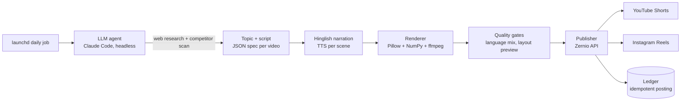

# CreatorOS Autopilot

An autonomous AI Shorts pipeline that researches what is new in AI, writes short explainer scripts, voices them in Hinglish, renders animated 1080×1920 videos and publishes them to **YouTube Shorts** and **Instagram Reels** every day, with no manual steps.

It runs the [Nexlore AI](https://www.youtube.com/@NexloreAI/shorts) channels: [YouTube](https://www.youtube.com/@NexloreAI/shorts) · [Instagram](https://www.instagram.com/nexloreai/reels/)

## How it works



1. **Research.** A headless LLM agent (`claude -p`) searches the last 48 hours of AI news, papers and enterprise stories, scans what is working for similar creators, and picks topics that have not been covered before (deduplicated against a history log).
2. **Script.** Each video becomes a JSON spec: 6–8 typed scenes (`hook`, `section`, `stat`, `points`, `predict`, `cta`), a narration line per scene, sources, and per-platform titles, captions and tags. Writing rules live in `prompts/playbooks/`.
3. **Voice.** Narration is Hindi–English code-switched ("Hinglish"). `shorts/make_audio.py` generates one clip per scene through a pluggable TTS backend (ElevenLabs, Azure AI Speech, OpenAI, Sarvam, Cartesia, Google, or macOS `say` as an offline fallback). `shorts/langmix.py` checks each script's English/Hindi balance before rendering.
4. **Render.** `engine/shorts_engine.py` draws every frame at 2× with Pillow and NumPy (animated grid background, glass cards, code chips, progress bar, brand header), times each scene to its narration, ducks the music under the voice and encodes with ffmpeg. A contact-sheet preview is checked before the full render.
5. **Publish.** `publish_zernio.py` uploads the same MP4 to YouTube and Instagram through the Zernio API at fixed IST slots. Every post is written to a ledger keyed on `(video, platform)`, so re-runs never double-post.

## Design choices

- **Config as data.** Each platform (`platforms/*.json`) and each content pillar (`pillars/*.json`) is a JSON file. Adding a platform or a series is a new file, not a code change. See [`STRUCTURE.md`](STRUCTURE.md).
- **Render ahead, publish later.** Four videos take hours to render, so videos render one day and publish on the next day's slots. The pipeline always holds a day of stock, and a failed run does not leave a gap.
- **Safe by default.** A lock prevents overlapping runs, a publish mode switch (`draft` / `schedule` / `auto`) controls what goes live, and the ledger makes publishing idempotent.
- **No heavy dependencies.** The engine and the Zernio client use only the standard library plus Pillow and NumPy.

## Tech stack

Python · Bash · LLM agents (Claude Code) · Text-to-speech APIs (ElevenLabs, Azure AI Speech) · Pillow · NumPy · ffmpeg · Zernio REST API · macOS launchd

## Repository layout

```
engine/            renderers (shorts_engine.py = current style, reel_engine.py = v1) and the Zernio client
shorts/            the daily pipeline: run_shorts.sh, make_audio.py, langmix.py, STYLE.md, example specs
prompts/           agent instructions and writing playbooks (story, Hinglish voice, metadata, critic)
platforms/         one JSON per destination: format limits, caption rules, which API key reaches it
pillars/           one JSON per content series: slot, ordering, schedule
publish_*.py       publishers and draft promotion tools
config.env         all non-secret settings
.env.example       the secrets the pipeline can use (copy to .env)
docs/OPERATIONS.md day-to-day commands and settings in detail
```

## Run it

Requirements: macOS, Python 3.10+, ffmpeg, the Claude Code CLI, and API keys for one TTS service and Zernio.

```bash
cp .env.example .env               # add your keys; .env is gitignored
brew install ffmpeg
shorts/setup_shorts.sh             # creates .venv and installs the daily launchd job
shorts/run_shorts.sh               # run the full pipeline now
shorts/run_shorts.sh --status      # what has run today
```

Render a single spec by hand:

```bash
python3 engine/shorts_engine.py preview shorts/examples/kv-cache.json   # contact sheet
python3 engine/shorts_engine.py render  shorts/examples/kv-cache.json   # full video
```

## Secrets

API keys are read from `.env` only, which is gitignored. `config.env` holds settings and never secrets. Background music is not included; add your own royalty-free tracks to `shorts/music/`.
