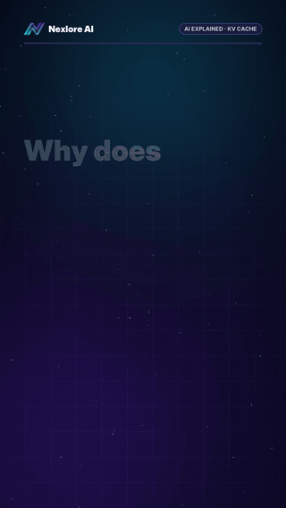
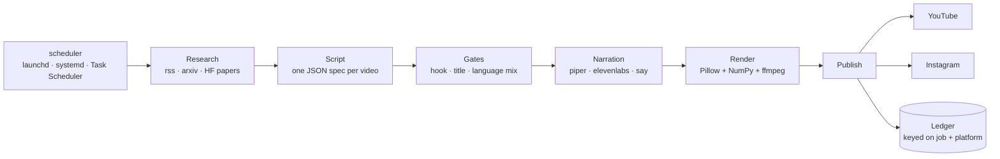
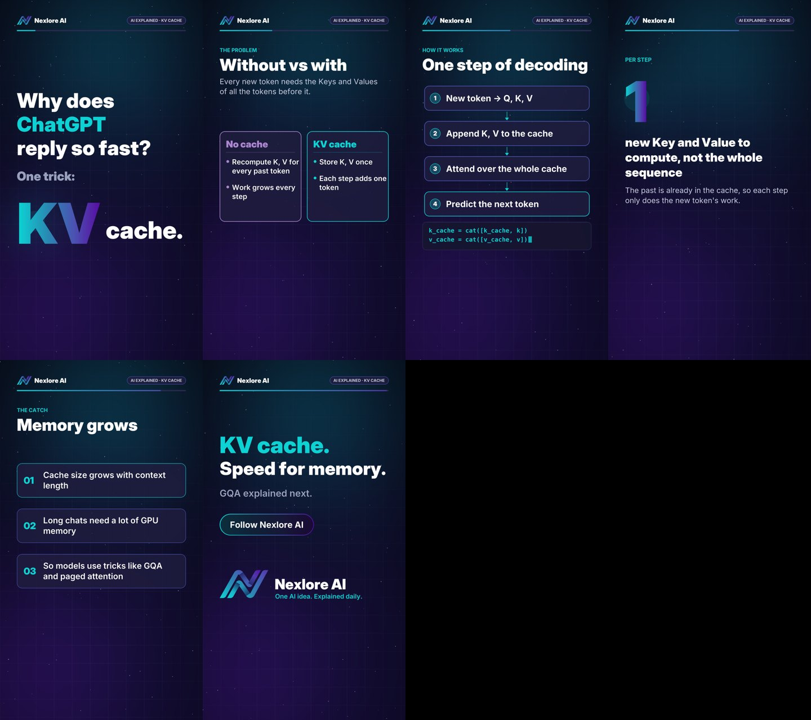
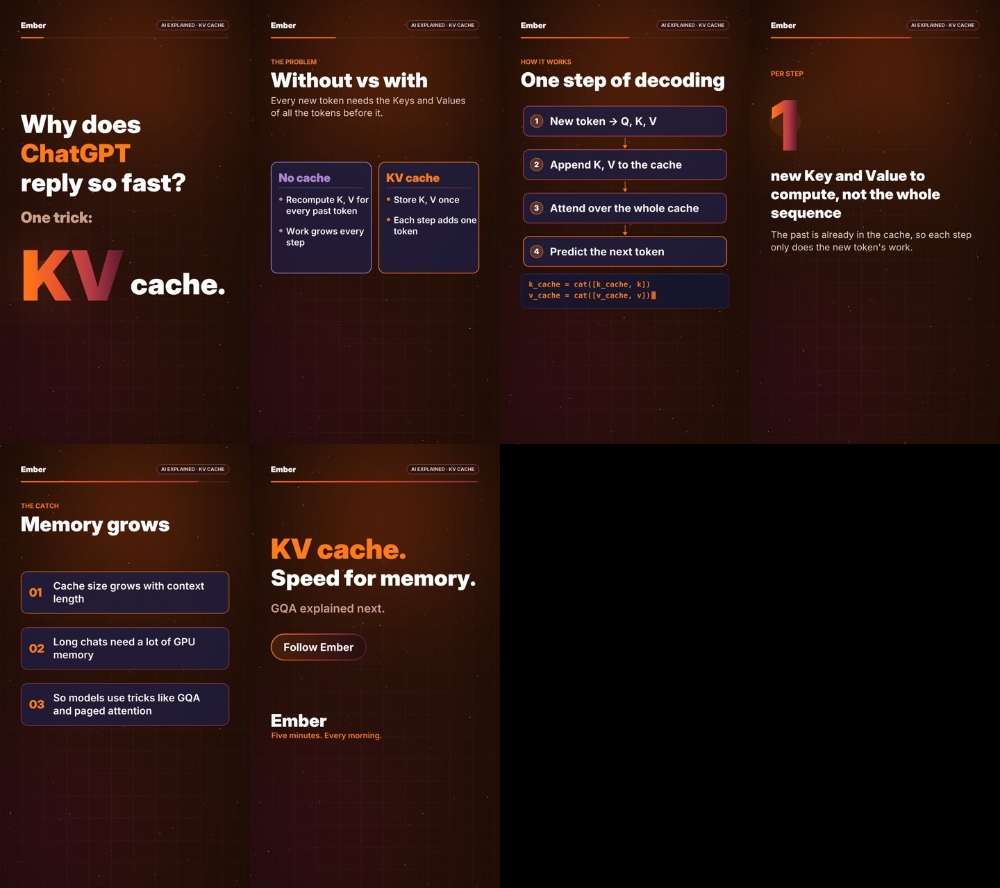
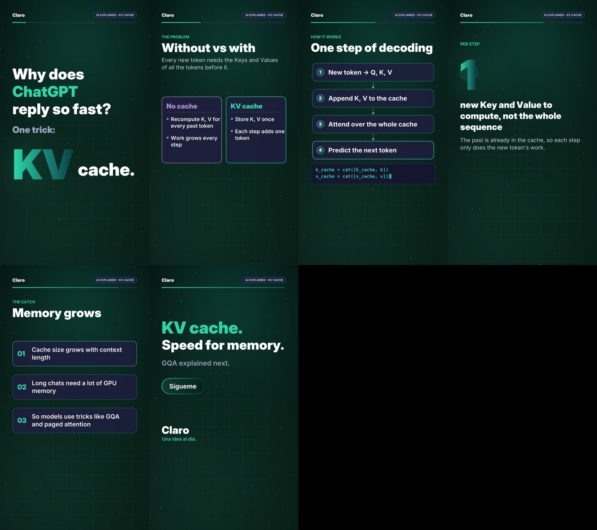

<div align="center">

# CreatorOS Autopilot

**Research, write, voice, render and publish short videos — on your machine, with your keys.**

[](https://github.com/Nexlore-AI/CreatorOS-Autopilot/actions/workflows/ci.yml)
[](LICENSE)
[](https://www.python.org/downloads/)
[](#requirements)



*A real render, not a mock-up — this is `examples/specs/kv-cache.json` through the shipped engine.*

</div>

---

It runs the [Nexlore AI](https://www.youtube.com/@NexloreAI/shorts) channels: **49 videos
published over 10 days** so far, to
[YouTube Shorts](https://www.youtube.com/@NexloreAI/shorts) and
[Instagram Reels](https://www.instagram.com/nexloreai/reels/), unattended. It is young —
this is the thing I actually use, not a thing I used for years and then open-sourced.

> **Status: early but real.** Phases 1–4 of [the roadmap](docs/ROADMAP.md) have landed. The
> command surface is stable; internals still move. The YouTube and Instagram publishers are
> written and unit-tested but have **not** been run against the live APIs yet — see
> [Provider support](#provider-support).

## Try it

```bash
pip install creatoros-autopilot        # Python 3.10+, and ffmpeg on PATH
creatoros init --yes
creatoros render examples/specs/kv-cache.json -o first.mp4
```

That writes a real 33-second 1080×1920 video. **19 seconds, no API key, no account** — on a
clean machine, timed. Rendering is the part that is free and offline, and it is deliberately
the first thing you can do.

Prefer Docker?

```bash
docker compose run --rm creatoros render examples/specs/kv-cache.json -o /workspace/out.mp4
```

## What it does



1. **Research.** Pluggable sources find candidate topics and deduplicate them across feeds.
2. **Script.** Each video becomes a JSON spec: typed scenes, a narration line per scene,
   sources, per-platform metadata. The spec is the job — everything downstream reads it and
   nothing else, which is why the same job can later run on a server.
3. **Gate.** Checks that encode your house style, opt-in, before anything expensive happens.
4. **Voice.** One clip per scene. A clip is only regenerated when its line changed, so a
   re-render does not re-bill the whole video.
5. **Render.** Every frame drawn at 2× with Pillow and NumPy, timed to the narration, music
   ducked under the voice, encoded with ffmpeg. No browser, no GPU.
6. **Publish.** Each post recorded in an append-only ledger keyed on `(job id, platform)`,
   so a re-run never double-posts and a partial failure retries only what failed.

## Make it yours

A brand kit is a YAML file. Same spec, three channels:

| | | |
|---|---|---|
|  |  |  |
| **Nexlore AI** — Hinglish, logo | **Ember** — English, wordmark | **Claro** — Spanish |

```yaml
name: Ember
tagline: Five minutes. Every morning.
cta: Follow Ember
palette:
  accent: "#FF7A18"
language:
  primary: en
```

Nothing in it is required. A missing logo renders a wordmark; a missing font falls back to
the bundled one. **A day's run is not lost because an image moved.** The three presets in
[`examples/`](examples/) are complete, copyable channels.

## Provider support

Everything external is a plugin. `creatoros doctor` lists what is installed and whether it
can run. **Free** means no key, no account, no bill.

| Kind | Provider | Free | Notes |
|---|---|:--:|---|
| **TTS** | `piper` | ✅ | local neural voices, fully offline |
| | `say` | ✅ | macOS only |
| | `elevenlabs` | | the best quality, and the one that costs money |
| **LLM** | `ollama` | ✅ | local models; writes specs, cannot run the research agent |
| | `claude_code` | | the full daily run: web research, competitor scan, self-review |
| **Publish** | `local_folder` | ✅ | writes the video plus the metadata that *would* be posted |
| | `youtube` | ✅ | Data API v3 · **not yet run against the live API** |
| | `instagram` | ✅ | Graph API, needs a Business account · **not yet run live** |
| | `zernio` | | one upload reaches both platforms |
| **Research** | `rss` · `arxiv` · `huggingface_papers` | ✅ | |
| **Style** | `nexlore-v3` | ✅ | the look above |
| **Gates** | `langmix` | ✅ | language-mix check on the narration |

**Adding one is a file and an entry point**, with no change to `creatoros_autopilot/core/` —
there is a test that reads the AST of every file in `core/` and fails if it so much as names
a provider.

```toml
[project.entry-points."creatoros.tts"]
my-voice = "my_package.voices:MyVoice"
```

See [docs/plugins/first-plugin.md](docs/plugins/first-plugin.md).

## Safe by default

- **Nothing publishes until you say so.** `publish.mode` ships as `draft` and
  `publish.platforms` ships empty.
- **Secrets only in `.env`**, written `0600`, never echoed. No settings object holds a key,
  so dumping settings cannot leak one. A pre-commit hook rejects key-shaped values in any
  config file.
- **Idempotent publishing.** The ledger is append-only and keyed on the job, not on a file
  path — so moving your output folder does not re-arm every video for posting.
- **AI narration disclosed** on every upload whose API supports it, and warned about loudly
  where it does not.

## Requirements

Python 3.10+ and ffmpeg. That is all for rendering. Narration needs a TTS backend,
publishing needs an account, the research agent needs an LLM — each optional, each reported
by `creatoros doctor`.

## Commands

| | |
|---|---|
| `creatoros init` | set up `creatoros.yaml` and `.env` |
| `creatoros doctor` | what is installed, what is missing, and how to fix it |
| `creatoros render` / `preview` | spec → MP4, or a contact sheet of every scene |
| `creatoros audio` | narration and a music bed |
| `creatoros publish` | one video (`--dry-run` prints the payload and calls nothing) |
| `creatoros run` | a full day: make the videos, then publish them |
| `creatoros status` | what has run, what is pending |
| `creatoros brands` | the brand kits available |
| `creatoros schedule` | the daily job, as a native OS unit |

[docs/OPERATIONS.md](docs/OPERATIONS.md) covers day-to-day use.

## Roadmap

Phases 1–4 are done: packaged and cross-platform, a plugin system, brand kits and
onboarding, contributor tooling. Next: migrating the Nexlore channel onto the new CLI, then
a design for a **hosted version** — describe what you want posted, and our workers render and
publish it. The open-source core and that product share this code; see
[docs/ROADMAP.md](docs/ROADMAP.md).

## Contributing

[`docs/seed-issues/`](docs/seed-issues/) has 18 scoped issues with real starting points — 10
of them sized for an afternoon. [CONTRIBUTING.md](CONTRIBUTING.md) has the three rules that
hold the architecture together, each enforced by a test rather than by review.

The single most useful contribution right now: run the `youtube` or `instagram` publisher
against the live API once and report what breaks.

## Licence

[AGPL-3.0-or-later](LICENSE). Run, modify and redistribute freely; if you run a **modified**
version as a network service, publish your changes. Contributions are covered by
[CLA.md](CLA.md).

Third-party, licences intact: the bundled YouTube skills are MIT (Jake Schincariol); Inter
and Poppins are under the SIL Open Font License, DejaVu Sans Mono under its own. No music is
bundled — add your own.
