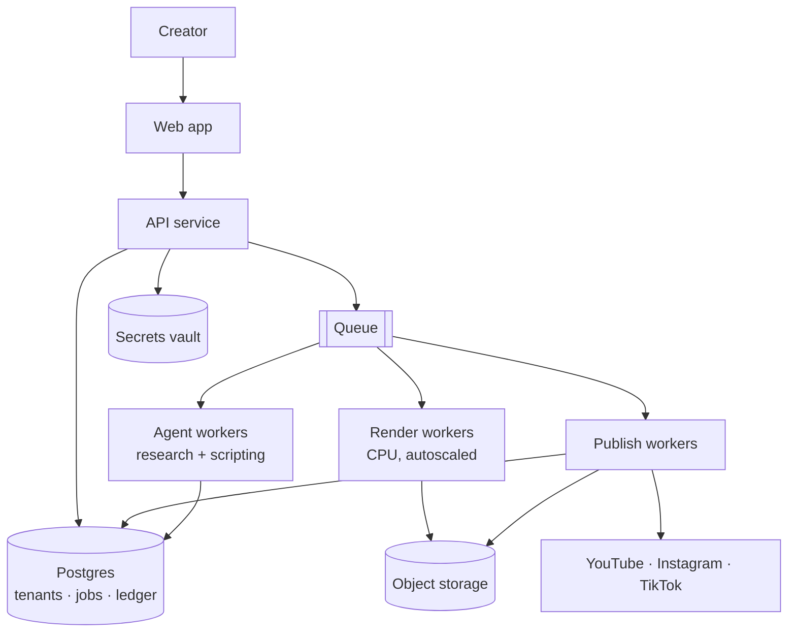

# Hosted CreatorOS — architecture

**Design only. Nothing here is built, and nothing in this repository depends on it.**

The product: a creator describes what they want posted — a niche, a brand, a cadence — and
our servers research, write, voice, render and publish it. They never install anything.

This document is about what that costs architecturally, which parts of the open-source core
already fit, and the three decisions that are hard to reverse.

---

## 1. What already fits

Most of the work for this was done by making the CLI run anywhere, and that was not an
accident — §2 of [ROADMAP.md](ROADMAP.md) chose the shape with this in mind.

| Already true | Why it matters here |
|---|---|
| **A video is a spec in, an MP4 plus metadata out** | That is a job. The worker contract already exists. |
| **No path is built from `$HOME`; everything hangs off `workspace`** | A worker points `workspace` at a scratch volume and nothing else changes. |
| **No OS-specific code outside `runtime/`** | Workers are Linux containers. Enforced by a test. |
| **Every provider is an entry point** | A tenant's choice of TTS or publisher is a string in their config, resolved at run time. |
| **The ledger is keyed on `(job id, platform)`, not a path** | Survives a job running on a different machine each time — which was *already* why it was changed. |
| **Settings hold no secrets** | A settings object can be logged, cached and sent between services without a vault leak. |
| **`publish.mode` defaults to draft** | The multi-tenant default is "nothing goes out until the tenant says so". |

**What does not fit, and must change:**

- The ledger is an append-only file. Multi-tenant needs a database with a unique constraint
  on `(tenant, job, platform)` — the file's guarantee comes from being the only writer.
- `core/lock.py` is a directory lock on one filesystem. Distributed runs need a lease.
- `core/pipeline.py` runs the stages in one process. The hosted version needs them as
  separate queue steps so a failed publish does not re-render.
- Rendering is CPU-bound and single-tenant-sized: **~22 s for a 33 s video on 6 cores**.
  That is the unit economics of the whole product (§4).

---

## 2. Services



**API service.** Thin. Owns tenants, brands, schedules and job state; enqueues work; signs
URLs for object storage. Never renders, never calls a platform API — so it can be scaled on
request rate alone.

**Agent workers.** Research and scripting. IO-bound, cheap, and the only tier that talks to
an LLM. Output is a spec row.

**Render workers.** The expensive tier. Pure CPU: Pillow and NumPy draw every frame, ffmpeg
encodes. **GPU is not useful here** — nothing in the renderer is a matrix operation a GPU
would accelerate, and `libx264` on CPU is fine for 1080×1920. A GPU tier only becomes
interesting if a future style does video diffusion, which is a different product decision.

**Publish workers.** Separate from render on purpose. Publishing is slow, asynchronous and
fails in ways retrying fixes; re-rendering a video because an Instagram container timed out
would be absurd. This tier holds the only code that touches a tenant's OAuth tokens.

**Why four tiers and not one.** Their scaling signals are unrelated: agents by topic volume,
render by minutes of video, publish by slot times — which cluster hard at 09:00 local in
whichever timezones the tenants are in.

---

## 3. The job model

One row per video, moving through states. Each transition is a queue message.

```
queued → researching → scripted → gated → voiced → rendered → scheduled → published
                                     ↓        ↓        ↓           ↓
                                  rejected  failed   failed     failed
```

Three rules, all carried over from the CLI because they were learned the hard way:

**Idempotency is per `(tenant, job, platform)`.** A retried publish must not post twice.
In Postgres this is a unique partial index on successful rows, which is the database version
of the append-only ledger.

**A step that cannot say whether it succeeded must not report success.** The CLI learned
this three times: a publisher that wrote files and posted nothing recorded the job as done;
a TTS backend that could not pronounce a script wrote a silent file and marked it fresh; a
resumable upload skipped its final probe and would have re-uploaded a video that had
arrived. Each has a direct analogue here, and each is worse when the user cannot see the
logs.

**Artifacts are content-addressed.** `tenant/job/sha256.mp4`. A re-render produces the same
key or a different one, and both are informative.

---

## 4. The economics, because they decide the architecture

A render worker produces **roughly 90 seconds of finished video per minute of 6-core CPU**
(measured: 22 s for a 33.5 s video). A tenant posting four 40-second videos a day needs
about **two CPU-minutes a day**. That is cheap — but the demand is not smooth: everyone
wants their video ready before their morning slot, so load arrives in a few hours of the
day, per timezone.

Three consequences:

1. **Render ahead, not just-in-time.** The CLI already does this (`offset_days: 1`) for the
   same reason: a four-video day takes hours and must not race its own first slot. Hosted,
   it is also what lets a worker pool be sized for the daily average rather than the peak.
2. **Spot instances are a good fit.** A render is idempotent and restartable; losing one
   costs 22 seconds.
3. **TTS, not CPU, is the variable cost.** At ~600 characters a video, a 4-a-day tenant is
   ~72,000 characters a month — above several providers' entry tiers. **Per-tenant TTS
   budgeting is a launch requirement, not a later feature**, and the free local path
   (Piper on a worker) is what makes a free tier possible at all.

---

## 5. Secrets and OAuth

**Per-tenant secrets live in a vault** (KMS-backed), never in the database, never in a
settings object. The CLI's rule — `Settings` holds no key — is what makes this a
configuration change rather than a refactor.

**Social accounts are OAuth, not API keys.** The hosted product cannot ask a creator for a
YouTube refresh token; it has to *be* the OAuth app. That means:

- Our own Google Cloud project and Meta app, both of which need **platform review** —
  YouTube's `youtube.upload` scope and Instagram's content publishing permissions are not
  self-serve. This is a **multi-week lead time and belongs on the critical path**.
- Token refresh is a background job per tenant per platform. A revoked token must surface in
  the UI as an action, not as a failed job.
- A publish worker holds a decrypted token for the duration of one upload and no longer.

**Zernio stays supported** for tenants who bring their own, because it sidesteps all of the
above — but it cannot be the hosted default: a product whose publishing depends on a third
party's quota is a product with someone else's outage page.

---

## 6. Multi-tenancy

Row-level isolation in one Postgres, with `tenant_id` on every table and RLS policies. Not
a database per tenant: the data is small and the operational cost of thousands of schemas
is not worth it below a scale this product will not reach for years.

**Workers are the real isolation boundary**, because they execute tenant-authored content.
A spec is data, but a brand kit names font files, a research source names URLs, and a future
style plugin would be code. So: one container per job, no network except an egress
allow-list, a read-only root filesystem, and a scratch volume that is destroyed with the
container.

**Tenant-supplied plugins are out of scope for v1.** Entry-point loading is arbitrary code
execution by design — exactly right on your own machine, unacceptable on ours. The hosted
product ships a fixed provider set. Say so in the product, because it is a genuine
difference from self-hosting and creators will ask.

---

## 7. Content moderation

The product generates and publishes content in a creator's name, automatically. That
obligation cannot be delegated to the platforms' own review.

| Stage | Check |
|---|---|
| Topic chosen | against a per-tenant blocklist and a global one |
| Script written | a moderation pass before anything is voiced or rendered — the cheapest place to stop |
| Facts | every factual claim carries a source; a spec without sources is flagged for review |
| Before publish | AI-narration disclosure set wherever the API has a field, and the absence surfaced where it does not |
| After publish | a takedown path that can unpublish across every platform a job reached |

**The policy question the architecture cannot answer:** what happens when the agent writes
something defamatory, or wrong, about a real person or company. A hosted service is a
publisher in a way a CLI on someone's laptop is not. The answer — human review tier, a
narrower topic space, tenant indemnity, or all three — is a product and legal decision that
should be made **before** launch, not after the first incident.

---

## 8. Open core: what is shared, what is not

```
creatoros-autopilot  (AGPL-3.0, this repo)
├── core/         job model, spec, ledger semantics, schedule   → shared verbatim
├── interfaces/   the six protocols                             → shared verbatim
├── render/       the engine and styles                         → shared verbatim
├── providers/    every provider                                → shared verbatim
└── cli/                                                        → not used hosted

creatoros-cloud  (proprietary)
├── api/          tenants, auth, billing, scheduling
├── workers/      queue adapters wrapping core.pipeline's stages
├── storage/      S3 Storage implementation of the core interface
├── vault/        per-tenant secrets
└── web/
```

**The hosted product depends on the open package as a dependency, pinned.** Not a fork, not
a vendored copy. The moment the cloud repo patches `render/` locally, the open version
becomes a demo of the real one, and every contributor's work starts landing in the thing
nobody runs.

**The test that keeps this honest:** anything the hosted product needs from `core/` must be
expressible through a public interface. If a cloud worker needs a private attribute, that is
a missing interface in the open repo — fix it there.

**AGPL is why the hosted product can be proprietary.** We hold the copyright through the
CLA, so we licence our own code to ourselves; everyone else running a modified version as a
service must publish their changes. That is the whole bargain, and it only holds if the CLA
is actually signed — see [CLA.md](../CLA.md), which is still a draft and needs a lawyer.

---

## 9. What to build first

Not the order it is written above.

1. **Start the OAuth reviews.** Google and Meta take weeks and block the product entirely.
2. **One worker, one tenant, no UI.** Take the existing pipeline, run it in a container
   against S3 and Postgres, for the Nexlore channel. It proves the core needs no fork.
3. **Storage and Queue interfaces in the open repo.** They are in §2 of the roadmap and not
   yet built; building them here is what keeps step 2 honest.
4. **The ledger as a database table**, behind the same interface, with the unique constraint.
5. Only then: tenants, billing, UI.

**The order matters because steps 2–4 are contributions to the open repo.** If the first
thing built is the web app, the core will be forked within a month and this document becomes
a description of something that did not happen.

---

## 10. Open questions

- **Does a free tier exist?** Piper plus a local model on a worker makes it technically
  possible. Whether it is commercially sensible is a different question, and the answer
  changes the worker pool's shape.
- **Who owns a published video?** The creator, clearly — but say it in the terms, and decide
  what happens to their scheduled posts when they stop paying mid-week.
- **What happens on a platform policy change?** Instagram's Reels API has changed twice in
  the last two years. The publisher interface absorbs it; the schedule a tenant has already
  agreed to does not.
- **Review tier or not** (§7). The most consequential question here, and the least technical.
